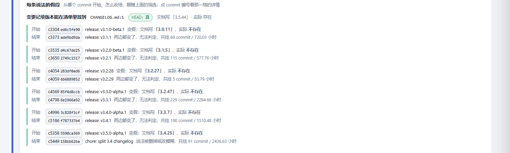
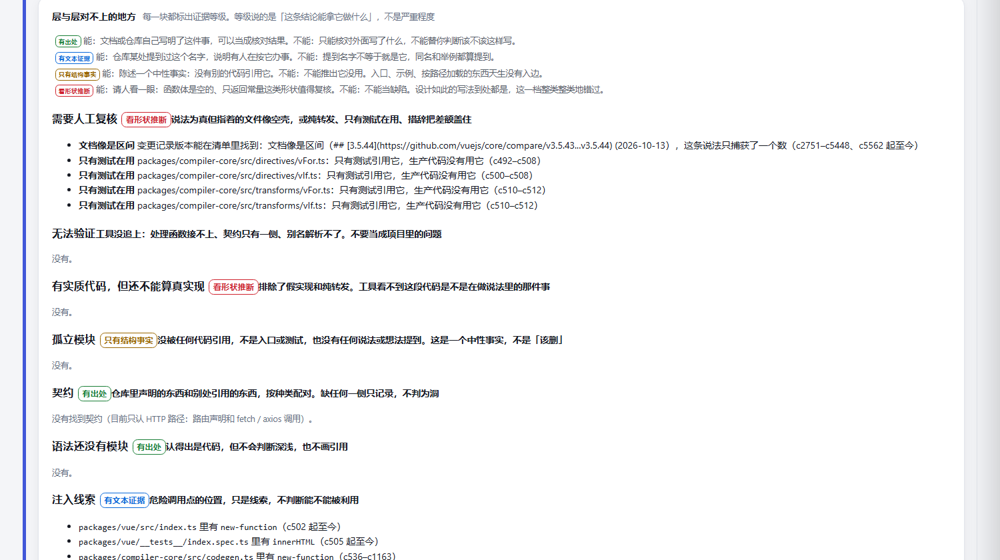
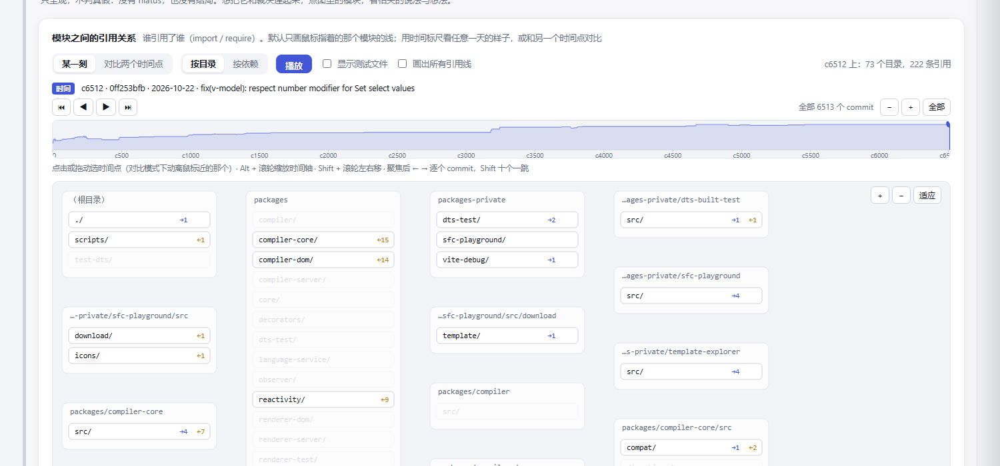

# laminae

[中文](README.md) | [English](README.en.md)

**Take a sentence from a document and check whether it was true at every commit.**

Not "is it true now", but **when it started being false, how long it stayed false, and how it ended**.

Everything below comes from a real repository, [vuejs/core](https://github.com/vuejs/core): 6513 mainline commits, 4 claims. [Open the report](docs/demo/vue-report.html) (one file, 1.8 MB, data and scripts inlined, no external requests).

---

## 1. What it answers


Median hiatus **91 commits / 720 hours**: from the moment a claim turns false to the moment it is settled, 91 commits pass.

The sample is 6 true-then-false runs, none still hanging. Of the 4 claims, 1 was false at some point; all 4 are true at HEAD.

## 2. How long each false run lasted, and how it ended



No clicking required: which commit it turned false at, what the document said then, what was actually there, which commit settled it and how, and how long it hung.

The "bumped the package, forgot the changelog" shape is plain to see: `3.0.11` is in the document and absent from the manifest; 69 commits later it was fixed.

## 3. One layer down


When a claim is true but the file it points at looks hollow, it is marked. **0 currently holding; another 44 appeared only in historical commits**, folded away so they do not take up the page.

## 4. What each conclusion can be used for



This is the most important column in the whole tool. The four grades say **what a conclusion can be used for**, not how severe it is:

| Grade | Can | Cannot |
|---|---|---|
| **stated** | the document or the repository itself says so; usable as a verification result | it only checks what someone wrote |
| **mentioned** | the name appears somewhere, so someone is working with it | a name mentioned is not the file itself |
| **structural fact only** | states "no other code references it" | **it does not follow that the file is unused**; entry points and examples have no incoming edge by nature |
| **inferred from shape** | ask a human to look at those shapes | **it is not a defect**; writing it this way is everywhere |

The column is enforced by the type system: add a new bucket without a grade and it will not compile.

## 5. What the structure looks like



A per-commit module reference graph, module-level imports only. By default it only draws the lines of the module under the cursor. Below it is a module-count curve you can pick a point on.

---

## Running it

Needs git, and a Node that can run `.ts` directly (validated on 24.7). The target project needs no dependencies.

```bash
node <laminae>/scripts/init.ts        # pick candidates out of the docs, check them at HEAD, write claims.json
node <laminae>/scripts/run.ts         # run the whole pipeline
```

`init` only **proposes and checks**; it does not judge true or false. It lays out what each candidate captured, what value the fact measured, and whether that fact is still a placeholder. The one thing left to a human is **what that sentence should actually count**.

The report lands at `<project>/.laminae/runs/<id>/laminae.html`.

Full flags, environment variables and output paths are in [REFERENCE](docs/REFERENCE.en.md).

---

## How to read the result

Each commit has one of four states:

| Value | Meaning |
|---|---|
| 0 | true |
| 1 | false |
| 2 | not yet in the document (that commit's document does not contain the claim; not "unfinished", not false) |
| 3 | cannot be measured (the document has it, but the fact cannot be measured at that commit) |

A consecutive false stretch is a false run, and its length is the hiatus. Every run is classified by how it ended: reality caught up with the claim / the document caught up with reality / the document was corrected / the claim was deleted / both changed / still hanging.

**The median hiatus uses a Kaplan-Meier estimate.** Runs still hanging at HEAD are treated as right-censored: a plain median would treat them as "ended here" and come out too small. When censoring is too heavy and the curve never reaches 50%, it says "cannot be estimated".

---

## It verifies; it does not screen

| | Verification | Screening |
|---|---|---|
| Who raised it | the document itself | the tool |
| Is there a source | yes, it points at a line | no, it is a heuristic |
| Who notices when wrong | it shows up on the first run | nobody |

**Verification output has never been wrong on a real repository; every failure came from "the tool thinks there is a problem"**, and it failed by whole categories: on click, 15 orphan modules and all 15 were wrong; on vue, 170 orphans and 119 of them did not even exist at HEAD.

After the fixes, click has 0 orphans and vue has 0. **Screening output must either carry evidence or stop appearing as a problem.**

---

## Boundaries

Not a to-do list; these are limits of the frame of reference.

- **Syntax is hand-written per language.** JS/TS (including SFC), Python, Rust. Java, Go, C# are only reported as "recognised, no module" and are **never judged true or false**.
- **"Has substantial code" is not "really implemented".** This section does not execute code and does not know whether a formula is right. To reach numbers computed inside a function body, use `test-passes` / `invariant-holds` / `output-unchanged`.
- **A claim captures one number.** "1600–1800" has to be split into two claims; "1600+" needs `compare: gte` written by hand.
- **Commands are laid out before they run.** The command verbatim, how many times it will run, and where it came from — if `claims.json` came with the repository rather than from this machine's git identity, it does not run.

The complete list of boundaries, the repositories validated, and known issues are in [Status](docs/STATUS.en.md), [Pitfalls](docs/LESSONS.en.md) and [Reference](docs/REFERENCE.en.md).

---

## More

| To find out | Read |
|---|---|
| Every false positive and every operational mistake, in full | [Pitfalls](docs/LESSONS.en.md) |
| Which real repositories it was validated on, and what is still missing | [Status](docs/STATUS.en.md) |
| Command-line flags, environment variables, output paths | [Reference](docs/REFERENCE.en.md) |
| How to write a claim and which fact type to pick | [Claim patterns](docs/PATTERNS.en.md) |
| Data model and measurement rules | [Spec](docs/SPEC.en.md) |
| What adding a language involves | [Languages](docs/LANGUAGES.en.md) |

292 tests, more than 30 of them end-to-end (they really spawn subprocesses and run the whole pipeline).

MIT licensed.
