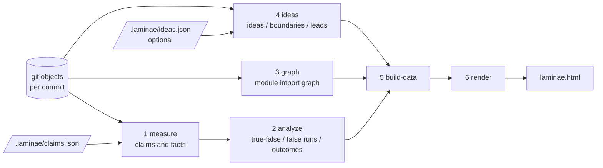

# laminae

[中文](README.md) | [English](README.en.md)

Verifies commit by commit whether the two sides agree, records the true or false state of every claim at every commit as a timeline, and from that computes:

- when a claim started being false, and how long it stayed false (`hiatus`, reported in both commit count and hours)
- how a false run finally ended (outcome classification)

There are two kinds of criteria. Counting the repository (file count, JSON, paths, whether a piece of text is present) answers "is it there", and works for any language. Running something (whether tests pass, whether an invariant holds, whether the output for the same input changed) answers "from which cell onward it is wrong"; a miscomputed formula, a wrong definition, subtotals that do not add up can only be judged this way — laminae does not understand formulas itself. What you verify should be the kind of thing that, if it were wrong, would make someone do the wrong thing; merely measuring "is the name in this sentence still in the file" has no discriminating power for that kind of thing.

The report has three more blocks: ideas and boundaries, the JS/TS/Python module import graph, and places where layers do not line up. The latter two cannot read Java, Go, Rust, or C# syntax.

Used as an agent skill: whichever project directory you run it in is the project it verifies, and the result is written as a single-file interactive HTML at that project's root: `laminae.html`.

---

## Running

Requires git, and a Node that can run `.ts` files directly (verified on 24.7; for other versions, go by the environment check). The target project does not need to install dependencies.

The environment check script actually runs a short piece of TypeScript to verify, and prints the install command for whatever is missing:

```bash
powershell -File scripts/setup.ps1      # Windows
bash scripts/setup.sh                   # macOS / Linux
```

By default it only checks and does not change the system. Adding `-Install` (`--install` for `setup.sh`) makes it install through the system package manager, confirming each item first; adding `-Yes` (`--yes`) skips that confirmation. `setup.ps1` has been tested on Windows; `setup.sh` was only tested in check mode, and its install branch has not been verified on macOS or Linux.

1. In the target project, write `.laminae/claims.json` to declare the claims to verify (format in [SKILL.md](SKILL.en.md)).
2. Run it in the target project directory:

```bash
node /path/to/laminae/scripts/run.ts
```

3. Open `.laminae/runs/<id>/laminae.html` (`.laminae/latest` holds the id of the most recent run).

To use it as a skill, put this repository in the agent's skills directory; `SKILL.md` describes what the agent should do.

| Path | Description |
|---|---|
| `<project>/.laminae/claims.json` | Input: claim definitions |
| `<project>/.laminae/data/` | Intermediate data, one shared copy, overwritten every time, safe to delete |
| `<project>/.laminae/runs/<id>/payload.json` | Output: the complete data. Enough to re-render; you can diff two of them yourself, the tool has no compare command yet |
| `<project>/.laminae/runs/<id>/laminae.html` | Output: the report, with data, styles, and scripts all inlined, no external requests |
| `<project>/.laminae/latest` | The id of the most recent run |

Facts that count the repository only read git objects: no checkout, no modification of files the project already tracks, and no change to the project's own `.gitignore`. `test-passes`, `invariant-holds`, and `output-unchanged` execute the commands written in claims.json inside a temporary worktree, which is deleted as soon as measuring finishes, leaving the main working tree untouched. Generated artifacts are automatically registered in the target repository's `.git/info/exclude` (local only), so they do not show up in `git status`; `.laminae/claims.json` is not ignored.

By default the terminal prints only a compact summary, whose line count does not grow with the number of commits; add `--verbose` to print the full per-commit timeline.

For environment variables (all optional) and error handling, see [docs/REFERENCE.md](docs/REFERENCE.en.md).

The pipeline has six steps, and each can be run on its own (in the target project directory):

| Step | Command | What it does |
|---|---|---|
| 1 | `node src/measure.ts` | Measure facts commit by commit, read the document body |
| 2 | `node src/analyze.ts` | Decide true or false, compute hiatus and outcomes |
| 3 | `node src/graph.ts` | Extract the module import graph commit by commit (JS/TS/Python) |
| 4 | `node src/ideas.ts` | Check the ideas and boundaries in `ideas.json` commit by commit, and collect roadmap/TODO leads; with no `ideas.json` it only collects leads |
| 5 | `node src/build-data.ts` | Process into data that can be inlined into the HTML |
| 6 | `node src/render.ts` | Assemble into a single-file HTML |

`scripts/run.ts` runs these six steps in order; `node scripts/run.ts data` stops after step 5.

If you run the steps by hand without specifying a run id, it continues the run that `.laminae/latest` points to; to start a separate run, use `--new-run`. For a whole run, go through `scripts/run.ts`: it always gives a new id and never touches the old run by mistake.

---

## Multiple runs and multiple repositories

### Every run keeps a copy, nothing is overwritten

By default runs are named by time and land in `.laminae/runs/<id>/`. Two runs give two copies; **the previous one is not overwritten**.

```bash
node <laminae>/scripts/run.ts                      # a timestamp like 20261020T031422
node <laminae>/scripts/run.ts --run before-refactor # use a readable name
```

Only `payload.json` and `laminae.html` are kept. Intermediate data is a single shared copy, overwritten every time, so that a repository with hundreds of commits does not eat the disk. The cost is that drafts such as `facts.json` are no longer there: **after changing the decision rules, you cannot re-run the analysis on the old data**, only re-run the whole thing.

**Keeping a copy is not the same as having a comparison.** What is kept is a snapshot of each invocation, and what it can answer is: what the report said on a given day, from which claim onward the same repository's conclusions differ after the decision rules changed, and how much the repository itself moved. **"How long has this sentence been wrong" is answered by the per-commit false runs inside one run (`hiatus`); two reports are not needed.** The command that lines two `payload.json` files up and lists "which claims were false last time, and whether they still are" has not been written yet; for now you can only diff the two files yourself.

Running a second time with the same name overwrites that run, and says so in advance. A name may contain only letters, digits, dots, underscores, and hyphens, and no path separators: both `claims.json` and the command line can influence it, and without that guard artifacts could be written outside the repository.

### Several repositories under one project folder

Running directly in a directory that is not a repository but has repositories underneath lists them and prints commands you can paste as-is:

```bash
node <laminae>/scripts/run.ts          # list sub-repositories
node <laminae>/scripts/run.ts --all    # run all
node <laminae>/scripts/run.ts --repo services/api   # run just one
node <laminae>/scripts/run.ts --repos api,web       # name several
```

You can also write a list in `.laminae/repos.json`, and then just run `run.ts` from then on. The format is an array: repository paths, or `{ "name": ..., "path": ... }`.

**Each run is still single-repository**: its own `.laminae/runs/<id>/`, its own git objects, no interference. All repositories in the same orchestration share the same id, and the parent directory generates a summary page `.laminae/runs/<id>/index.html` listing an overview of each repository plus the longest-running false run across all of them.

The summary page is an index, not several repositories' grids stacked on top of each other — repositories have different commit counts, and `c27` in repository A is not the same thing as `c27` in repository B.

**Parallelism has one hard limit**: as soon as any repository uses `test-passes` / `invariant-holds` / `output-unchanged`, the run automatically switches to serial. Those commands start services, connect to test databases, and occupy ports; running them at the same time makes them fight, and failures get recorded as "unmeasurable" — it looks like a problem with the tool, but it is actually caused by concurrency. When you are sure they do not interfere, add `--allow-parallel-commands`.

```bash
node <laminae>/scripts/run.ts --all --jobs 4    # at most 4 concurrent, defaults to the CPU count
```



---

## What it does

**Claims and true or false.** Every claim is declared in `.laminae/claims.json`: the file it lives in, the regular expression used to locate the number, and the corresponding measurable fact (`fact`). Measuring reads, at every commit, the number the document writes and the number actually measured for the fact, and compares them to get true or false. Every commit has one of four states:

| Value | Meaning |
|---|---|
| 0 | true |
| 1 | false |
| 2 | not written yet (gray on the page; the claim is not in the document at that commit — not work left undone, and not false) |
| 3 | unmeasurable (the claim is in the document, but the corresponding fact cannot be measured at that commit) |

**False runs and outcomes.** A contiguous interval of false commits is called a false run, and its length is the hiatus. Each false run is classified by how it ended:

| Outcome | Meaning |
|---|---|
| still open, reality never moved | still false at HEAD, and the measured fact never changed |
| still open, reality has moved | still false at HEAD, the measured fact changed and the document did not keep up |
| reality caught up with the claim | the claim was made true by changing reality |
| the document caught up with reality | reality changed first, the document caught up afterwards |
| the document was corrected | reality did not change; the document had been wrong from the start |
| the claim was deleted or made vague | after the false run the claim can no longer be located |
| the fact cannot be measured | after the false run the fact cannot be read, so the ending cannot be decided |
| both sides changed | claim and fact changed together on the same commit, so it cannot be decided |
| flipped without cause | anomalous, needs investigation |

**Summary metrics.**
- Median hiatus: estimated with Kaplan-Meier, over the sample of false runs that were true first and false later (excluding born false). Runs still open at HEAD are treated as right-censored; taking the median directly would treat them as "ending here" and bias it low. When there is too much censoring and the curve never drops to 50%, it shows "cannot be estimated".
- Closure direction: among false runs that have closed and whose direction can be decided, what share went away by changing the document (adding it or correcting it), by deleting the claim, and by changing reality.
- The number of claims that were ever false, the number still false at HEAD, and the number born false (never true), plus the outcome distribution.

---

## The interface

`laminae.html` is a state history grid: commits on the horizontal axis, claims on the vertical axis, each cell the true or false state at that commit, drawn cell by cell with no merging. The state grid lays its cells out with CSS Grid. The module import graph is SVG. The whole report is still a single file, with no external requests and no dependence on a charting library.

Below the grid is a "false runs for each claim" list, visible without clicking anything open: where each false run started being false (including the commit title and the number the document wrote and the actual number at the time), which commit ended it and in what way, and how long it stayed open in total. The list follows the search and preset views above it, and clicking a commit number opens the drawer for that cell. Claims that never had a false run are not listed, only counted.

Clicking any cell opens a drawer on the right showing:

- `file:line`, with the link pinned to that commit (this needs the repository's web URL to be obtainable)
- the exact text the document actually wrote at that commit (with a note when the wording differs from HEAD)
- the "written in the document / actual" values
- the duration, end time, and outcome of this false run
- the state at HEAD and the cumulative share of false commits

Other interactions:

| Feature | How to use |
|---|---|
| Crosshair highlight | Move the mouse over a cell to highlight its row and column |
| Search | Filter by claim name, file, or original text |
| Preset views | All / still false / born false / was ever false / sorted by hiatus |
| Filter by state | Click the legend and the other states are dimmed |
| Jump to outcome | Click an outcome bar to jump to the first false run with that outcome |
| Playback | Step cell by cell through the commits |
| Keyboard | Arrow keys to move, Enter to open, Esc to close |
| Deep link | `laminae.html#r=3&c=27` goes straight to a cell |
| Theme | Follow system / light / dark |
| Export | Print to PDF from the browser |

### Two big blocks: verdict and description

The page is split into two large cards, each holding its own smaller cards, and they answer two different kinds of question:

| Block | What is inside | What it answers |
|---|---|---|
| **verdict** | the claim state grid, false runs and outcomes, ideas and boundaries, places where layers do not line up | whether what was said to hold still holds later. Every cell has checkable evidence, true or false is decided per commit, and hiatus and outcome are computed |
| **description** | the import graph, idea leads | what the structure looks like now, and what is brewing. Presentation only, no true or false, no hiatus, no outcome |

The bridge between the two blocks is the nodes in the graph: clicking a module lists the claims and ideas related to it, walking from description to verdict. Leads do not automatically become ideas; only after you confirm and write them into ideas.json do they count.

### Module import graph, ideas and boundaries

The header navigation is grouped by verdict and description. The subsections below appear only when the corresponding data exists.

- **Module import graph**: the module import graph for every commit, going only as far as module-level imports and no function calls, recognizing only JS/TS and Python. By default it draws only the lines of the module the mouse is pointing at (blue = what it imports, orange = what imports it). Modules in the same directory go into one card, and you can also switch to layering "by dependency". "A single moment" shows the structure; "compare two points in time" highlights added, disappeared, and retained modules and imports. Click a node to pin it and see what it imports, what imports it, and the related claims and ideas.
- **Time ruler**: underneath is a curve of the module count at each commit. Click or drag to pick a point in time, Alt + wheel zooms the time axis, Shift + wheel moves it left and right, and after focusing, ← → step commit by commit. The graph itself can also be zoomed with Alt + wheel and panned by dragging on empty space. The state grid's time axis zooms with Alt + wheel the same way, and by default fits the whole history into one screen.
- **Ideas and boundaries**: the ideas (done / not done) and boundaries (held / crossed) declared in `.laminae/ideas.json`. "Done" means the evidence holds (the path is there, the text is there, the key is there); an empty function also counts as done, unless the layers section flags it as a hollow implementation. Import boundaries (`import-edge`, e.g. "the frontend may not import the backend") are decided commit by commit, listing the imports that cross the boundary and marking them red on the graph. When an alias cannot be resolved it is recorded as "unmeasurable", not as held. For the format see [SKILL.md](SKILL.en.md).
- **Places where layers do not line up**: no configuration needed. The conclusions that hold are sorted into three tiers: structurally empty (empty file, written as not implemented, a function returning only an empty value, a pure re-export to an empty function), covered up another way (pure re-export, used only by tests, lower/upper-bound wording covering the gap, an alias or handler that cannot be seen clearly), and has substantial code but cannot yet count as a real implementation. It can only recognize structural emptiness, not a wrong computation. Judgments about formulas, definitions, and summation need a criterion supplied by tests, invariants, or output diffing. It does not assume a project has a frontend or a backend; a contract missing one side is only recorded, not counted as a hole. FastAPI's `APIRouter(prefix=)` and `include_router(..., prefix=)` are joined onto the decorator path before comparison. Injection leads only mark the location and do not decide.
- **Leads**: the `- [ ]` checklists in the roadmap and the TODOs in the code, with count trends. They are only leads, they do not mean the work was or was not really done, and they do not automatically become ideas.

## What it cannot do today

These are boundaries in the code, not plans for later. Details are in [docs/REFERENCE.md](docs/REFERENCE.en.md).

- **It recognizes only JS/TS and Python syntax.** Files with a recognizable extension among Java, Go, Rust, C#, and so on are listed under "no module for this syntax yet"; they do not enter the import graph, and no hollow implementation, re-export, or routing judgments are made for them. Document claims (counts, paths, text, JSON keys) do not look at syntax and can still be written. The steps for adding a language, and which steps shell can speed up, are in [docs/LANGUAGES.md](docs/LANGUAGES.en.md).
- **"Has substantial code" is not "really implemented".** The layers section does not execute code and does not know whether a formula computes correctly. A function that only does `return 1`, a bare number like that, now counts as structurally empty. Empty methods in classes, and syntax it cannot follow, still count as substantial code. To reach numbers computed inside a function body, use `test-passes`, `invariant-holds`, or `output-unchanged`.
- **What "covered up" recognizes.** Pure re-exports, referenced only by tests, `gte`/`lte`/`approx` with a relative gap of at least 15% and an absolute gap of at least 2, an alias that cannot be resolved, a route handler that was traced out of the repository, a document written as a range but with only one number captured. A small count that is off by just 1 does not count. A contract missing one side is listed, with a note that it is not treated as a hole. The two gap thresholds are set by hand, not estimated from samples.
- **A claim captures only one number.** "1600–1800" has to be split into a lower-bound claim and an upper-bound claim. The default is strict equality; "1600+" needs `"compare": "gte"` written by hand, otherwise it will be judged false. When the wording looks like a lower bound the terminal warns, but it does not change the verdict automatically.
- **Function calls follow only one case: "the whole function just calls another function", and at most two hops.** The function in question itself does not count as a hop. Hop 1 is a function in another file whose body is a single statement, namely calling it. Hop 2 is one more function further out, whose body is also a single statement, calling the previous hop. Nothing further out is followed. If the function contains other code besides that one statement, it is not followed. If what is called is a third-party package, it is not followed. This is not a complete call graph. Routing recognizes `app.get("/x")`, `@app.route("/x")`, `@router.get("/x")`, and `@Get("/x")` against `fetch` / `axios`. For Python it joins `APIRouter(prefix=)` and `include_router(..., prefix=)` onto the path, including across a file with `from users import router`. Paths containing variables are skipped. Injection leads include `os.system`, `subprocess`, and `document.write`, and still only mark the location.
- **"Look one level down" at the start of the report lands on the function and the line where it is defined, and does not judge the whole file empty.** When the file already contains other implementations, a lone `NotImplementedError` only flags that function. It is listed even when no claim points at it. The line number is the function definition line, not the `raise` line.
- **The commit sequence follows the mainline only** (`git log --first-parent`). Commits from merged-in branches are not in the sequence. Lucide has about 3000 commits in total; the mainline has 2562.
- **False positives have not been measured in bulk on real repositories yet.** The existing tests only show that the rules run as designed. There is also a batch of 9 examples with reader judgments written down in advance (constructed, not sampled from any repository): of the 7 that the tool marked as a hollow implementation or covered up, 3 were not considered problems by the reader (a barrel file, referenced only by tests, written as 1600+ when the actual value is 1899). The 4 that the reader did consider problems were all flagged this time, including the one that only does `return 1`. Hit rate 4/7, recall 1. On Lucide and google-analytics there were only manual trial runs, all of them constructed examples and a few spots looked at by hand, with no bulk sampling.

---

## Directory structure

```
SKILL.md       skill description (the agent reads this)
src/           Node side, TypeScript
  config.ts      target repository (the git repository the current directory is in) and run configuration
  exclude.ts     register generated artifacts in .git/info/exclude
  paths.ts       paths of claim definitions, run directories, and output files
  runid.ts       generating and validating the run id, the latest pointer
  repos.ts       repository list parsing and sub-repository discovery
  types.ts       shared types (four-state encoding and outcome enum)
  facts.ts       declaring, validating, and measuring fact types
  lookup.ts      look up the captured text and fact at HEAD before writing claims.json
  observe.ts     run tests, invariants, and output diffing (temporary worktree)
  claims.ts      reading and validating claim definitions
  measure.ts     measure commit by commit
  analyze.ts     time-series analysis
  classify.ts    segmentation and outcome classification (pure functions)
  compare.ts     comparison modes for numeric claims (equal / lower bound / upper bound / approximate, pure functions)
  gitutil.ts     git invocation and the commit sequence
  imports.ts     import statement parsing and path resolution (pure functions)
  graph-core.ts  merging and intervalizing the import graph (pure functions)
  layers-core.ts layer reconciliation: hollow implementation, covered up, has code but unproven (pure functions, JS/TS/Python only)
  scan.ts        import scanning (streaming reads of git objects, cached by file content), shared by the import graph and import boundaries
  graph.ts       extract the import graph commit by commit
  ideas-core.ts  validating and deciding ideas and boundaries (pure functions)
  candidates.ts  parsing roadmap and TODO leads (pure functions)
  ideas.ts       check ideas commit by commit, collect leads
  build-data.ts  build-time processing
  render.ts      assemble the single-file HTML
  indexhtml.ts   the summary page for multiple repositories
web/           browser side
  app.ts         interaction logic
  graph.ts       module import graph (time bar, comparison, node details)
  layout.ts      layered layout
  ideas.ts       status bands for ideas and boundaries, and leads
  ruler.ts       time ruler (zoom, drag, keyboard)
  gridzoom.ts    time axis zoom for the state grid
  shared.ts      shared time cursor and small utilities
  style.css      styles; themes switch through CSS variables
dist/          compiled output of app.ts (checked in, inlined into the HTML at render time)
test/          unit tests and end-to-end tests
scripts/       pipeline scripts
  run.ts         the whole pipeline
  setup.ps1      environment check (Windows)
  setup.sh       environment check (macOS / Linux)
  build-web.ts   compile the browser side to dist/app.js
  snapshot.ts    headless Chrome snapshots
docs/          design spec (SPEC.md), reference (REFERENCE.md), claim patterns (PATTERNS.md)
```

For design details see [docs/SPEC.md](docs/SPEC.en.md). When picking claims in a repository, consult [docs/PATTERNS.md](docs/PATTERNS.en.md) — a real document contains only a handful of claim patterns, and it lists there how to recognize each one, what facts can measure it, and when it cannot be measured.

---

## What to do when switching to another repository

laminae itself contains no project's paths, numbers, or file names. Switching repositories changes only the input, not the code:

1. Write `.laminae/claims.json` in that repository. When picking claims, check against [docs/PATTERNS.md](docs/PATTERNS.en.md).
2. Use `src/suggest.ts` to fish out a draft first, then check it once at HEAD with `src/lookup.ts`, and only write it in after it lines up.
3. Run `scripts/run.ts`.

What really decides whether this can be put to use is not the code but **whether the claims are picked accurately**: pick one claim wrong (`locator` matching a different sentence, `fact` counting the wrong thing) and the whole grid has one false position. So the `lookup` step cannot be skipped.

---

## Development

```bash
npm install
npm run typecheck
npm test
npm run build:web      # must run after changing web/, and commit dist/app.js
```

`npm test` includes end-to-end tests on a temporary git repository, covering historical cases such as a claim being deleted, a fact file being corrupted, merge commits, and file renames, as well as the skill usage of "run inside the project directory, with output landing inside the project".

---

## Acknowledgements

The interaction checklist drew on the public capability list of [archify](https://github.com/tt-a1i/archify) (none of its code was used). During the research phase we read the public descriptions of docclaims, docrot, staledocs, DOCER, and DocPrism; the design decisions to "store unmeasurable separately from false" and "what cannot be judged must not become a conclusion" are related to them, but **no code was imported**.

The published artifacts contain no third-party code, and `package.json` has no runtime dependencies. The full explanation is in [THIRD-PARTY-NOTICES.md](THIRD-PARTY-NOTICES.en.md) — including how to handle the three cases of an idea, an interface shape, and code, respectively, if someone else's material is to be added here.

---

## Security

The three facts `test-passes`, `invariant-holds`, and `output-unchanged` hand the `command` in `claims.json` to the shell, **with no sandbox and no allowlist**, at the same permissions as the runner. The working directory is that commit's temporary worktree, but the command can reach the entire file system.

**Do not run a `.laminae/claims.json` from an unknown source.** The nine facts that count the repository only read git objects and execute nothing.

For details, the constraints already in place, and how findings are reported, see [SECURITY.md](SECURITY.en.md).

---

## License and contributing

Released under [MIT](LICENSE). Commercial use is allowed, as are modification, redistribution, and sublicensing; the only obligation is to keep the copyright notice and the full license text.

Branch conventions, commit messages, and pre-commit checks are in [CONTRIBUTING.md](CONTRIBUTING.en.md).
