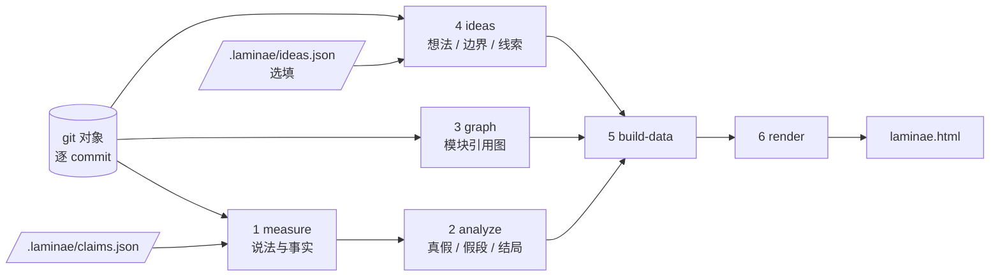

# laminae

[中文](README.md) | [English](README.en.md)

**先读这两份**：[踩过的坑](docs/LESSONS.md)（每一个误报和操作失误的完整记录）· [现状与已知问题](docs/STATUS.md)（能做什么、在哪些仓库上验证过、还欠什么）

逐 commit 核验两边是否一致，把每条说法在每个 commit 上的真假记成一条时间线，并据此算出：

- 说法从什么时候开始变假、假了多久（`hiatus`，同时给出 commit 数和小时数）
- 假段最后是怎么结束的（结局分类）

判据有两类。数仓库（文件个数、JSON、路径、某段文字在不在）回答「在不在」，任何语言都能测。跑出来的（测试过不过、不变量成不成立、同一份输入的输出变没变）回答「从哪一格开始不对」；公式算错、口径取错、分项加总对不上，只能走这一类，laminae 自己不懂公式。核的事情应当是错了会让人做错事的；只量「这句话里的名字还在不在文件里」，对这种事情没有区分力。

报告里还有三块：想法与边界、JS/TS/Python/Rust 的模块引用图、层与层对不上的地方。后两块读不懂 Java、Go、C# 的语法。

以 agent skill 的方式使用：在哪个项目目录下运行，就核验哪个项目，结果输出为该项目根目录下的单文件交互式 HTML：`laminae.html`。

---

## 运行

需要 git，以及能直接运行 `.ts` 文件的 Node（已在 24.7 上验证，其他版本以环境检查为准）。目标项目不需要安装依赖。

环境检查脚本会实际运行一小段 TypeScript 来验证，缺什么就打印安装命令：

```bash
powershell -File scripts/setup.ps1      # Windows
bash scripts/setup.sh                   # macOS / Linux
```

默认只检查，不改系统。加 `-Install`（`setup.sh` 为 `--install`）才会用系统包管理器安装，每一项先确认，再加 `-Yes`（`--yes`）则不确认。`setup.ps1` 在 Windows 上测过；`setup.sh` 只测了检查模式，安装分支没有在 macOS 和 Linux 上验证过。

1. 在目标项目里写 `.laminae/claims.json`，声明要核验的说法（格式见 [SKILL.md](SKILL.md)）。
2. 在目标项目目录下运行：

```bash
node /path/to/laminae/scripts/run.ts
```

3. 打开 `.laminae/runs/<id>/laminae.html`（`.laminae/latest` 里写着最近一次的 id）。

作为 skill 使用时，把本仓库放进 agent 的 skills 目录，`SKILL.md` 描述了 agent 该怎么做。

| 路径 | 说明 |
|---|---|
| `<项目>/.laminae/claims.json` | 输入：说法定义 |
| `<项目>/.laminae/data/` | 中间数据，共享一份，每次覆盖，可删 |
| `<项目>/.laminae/runs/<id>/payload.json` | 输出：完整数据。够重渲染；两份之间可以自己 diff，工具还没有对比命令 |
| `<项目>/.laminae/runs/<id>/laminae.html` | 输出：报告，数据、样式、脚本全部内联，无外部请求 |
| `<项目>/.laminae/latest` | 最近一次运行的 id |

数仓库的事实只读取 git 对象，不检出，不修改项目已跟踪的文件，也不改项目自己的 `.gitignore`。`test-passes`、`invariant-holds`、`output-unchanged` 会在临时 worktree 里执行 claims.json 里写的命令，测完即删，不改主工作区。生成物会自动登记到目标仓库的 `.git/info/exclude`（仅本地生效），不出现在 `git status` 里；`.laminae/claims.json` 不忽略。

**会执行命令这件事，跑之前先摊开。** 每次运行都会先打印每条命令的原文（不截断）、要跑多少次、以及它来自哪里：

```
  测试全过
    命令  npm test && npm run lint
    次数  watch src/**（只有这些文件变了的 commit 才跑）
    超时  默认 60 秒

  出处  .laminae/claims.json
        **这个文件被 git 跟踪**，是随仓库来的，不一定是使用者自己写的
        最后一次修改：someone <s@example.com>，2026-10-01
```

因为 `claims.json` 可以提交进仓库，克隆一个仓库再跑一次 laminae，就可能执行别人写好的命令。**这不是沙箱**——沙箱会让人以为「关起来了」，这里要做的是让人看见。

不想跑就用 `--no-commands`：连临时工作区都不开，那几条说法一律记成「测不出来」（不是假），报告顶部也会写明这次没跑命令。

终端默认只打印紧凑摘要，行数不随 commit 数增长；加 `--verbose` 打印完整的逐 commit 时间线。

环境变量（均选填）与报错处理见 [docs/REFERENCE.md](docs/REFERENCE.md)。

流程分六步，每步都可以单独运行（在目标项目目录下）：

| 步 | 命令 | 做什么 |
|---|---|---|
| 1 | `node src/measure.ts` | 逐 commit 测量事实，读取文档正文 |
| 2 | `node src/analyze.ts` | 判定真假，计算 hiatus 与结局 |
| 3 | `node src/graph.ts` | 逐 commit 提取模块引用图（JS/TS/Python） |
| 4 | `node src/ideas.ts` | 逐 commit 核对 `ideas.json` 里的想法与边界，并收集路线图/TODO 线索；没有 `ideas.json` 就只收线索 |
| 5 | `node src/build-data.ts` | 加工成可内联进 HTML 的数据 |
| 6 | `node src/render.ts` | 拼成单文件 HTML |

`scripts/run.ts` 依次执行这六步；`node scripts/run.ts data` 只跑到第 5 步。

分步手跑时不指定运行 id，就会接着 `.laminae/latest` 指向的那次；想另开一次用 `--new-run`。整次运行请走 `scripts/run.ts`，它总会给一个新 id，不会误碰旧的那次。

---

## 多次运行与多个仓库

### 每次运行留档，不覆盖

默认按时间命名，落在 `.laminae/runs/<id>/`。跑两次就有两份，**上一次不会被覆盖**。

```bash
node <laminae>/scripts/run.ts                      # 20261020T031422 这样的时间戳
node <laminae>/scripts/run.ts --run before-refactor # 用可读的名字
```

只有 `payload.json` 与 `laminae.html` 留档。中间数据共享一份、每次覆盖，免得几百个 commit 的仓库把磁盘吃光。

**改了解析或规则之后，不用整次重跑。** 六步是分开的，可以只跑其中几步：

```bash
node <laminae>/scripts/run.ts --from 2                # 从第 2 步起（跳过最贵的逐 commit 测量）
node <laminae>/scripts/run.ts --from analyze --to 5   # 名字里的一段也认
node <laminae>/scripts/run.ts --from 5                # 只重算构建期加工和渲染
```

vue（6513 个 commit）上实测：完整跑 426 秒，只重跑判定 1 秒、加工加渲染 2 秒，产物完全一致。
跳过的步骤依赖的中间数据不在时会停下来告诉你先跑哪一步 —— 不会让后面几步读到空文件、产出一份看起来正常的空报告。

**两份报告可以对比。** `scripts/diff.ts` 比说法的状态序列、层那几档的增减、图的节点与边、汇总口径：

```bash
node <laminae>/scripts/diff.ts <旧运行> <新运行>
```

**「这句话错着多久」由一次运行内的逐 commit 假段回答（`hiatus`），不需要两份报告。** `diff` 回答的是另一个问题：改了一条规则之后，结论从哪一条开始不一样。

同一个名字跑第二次会覆盖那一次，并提前说一声。名字只能含字母、数字、点、下划线、连字符，不能含路径分隔符：`claims.json` 和命令行都能影响它，不挡住就能把产物写到仓库外面。

### 一个项目文件夹下有几个仓库

直接在一个不是仓库、但下面有仓库的目录里跑，会把它们列出来并给出能直接粘的命令：

```bash
node <laminae>/scripts/run.ts          # 列出子仓库
node <laminae>/scripts/run.ts --all    # 全跑
node <laminae>/scripts/run.ts --repo services/api   # 只跑一个
node <laminae>/scripts/run.ts --repos api,web       # 指定几个
```

也可以在 `.laminae/repos.json` 里写清单，以后直接跑 `run.ts` 就行。写法是数组：仓库路径，或 `{ "name": ..., "path": ... }`。

**每次运行仍然是单仓库的**：各自的 `.laminae/runs/<id>/`，各自的 git 对象，互不影响。同一次编排里的所有仓库共用同一个 id，父目录会生成一张汇总页 `.laminae/runs/<id>/index.html`，列出每个仓库的概况，以及所有仓库里挂得最久的假段。

汇总页是索引，不是把几个仓库的网格叠在一起——各仓库 commit 数不同，`c27` 在 A 仓库和在 B 仓库不是同一件事。

**并行有一条硬限制**：只要任何一个仓库用了 `test-passes` / `invariant-holds` / `output-unchanged`，就自动改成串行。那些命令会起服务、连测试库、占端口，同时跑会互相打架，而且失败会被记成「测不出来」——看起来像工具的问题，其实是并发造成的。确定互不干扰时加 `--allow-parallel-commands`。

```bash
node <laminae>/scripts/run.ts --all --jobs 4    # 最多 4 个并发，默认按 CPU
```



---

## 做了什么

**说法与真假。** 每条说法在 `.laminae/claims.json` 里声明：所在文件、用来定位数字的正则、对应的被测事实（`fact`）。测量时在每个 commit 上读取文档里写的数和事实实际测到的数，比较得到真假。每个 commit 的状态有四种：

| 值 | 含义 |
|---|---|
| 0 | 真 |
| 1 | 假 |
| 2 | 尚未写入文档（页面上的灰色；该 commit 上文档里还没有这条说法，不是没做完，也不是假） |
| 3 | 测不出来（文档里有这条说法，但该 commit 上测不到对应的事实） |

**假段与结局。** 连续为假的 commit 区间称为一个假段，长度即 hiatus。每个假段按收场方式归类：

| 结局 | 含义 |
|---|---|
| 仍挂着，现实一直没动 | 到 HEAD 仍为假，被测事实没有变过 |
| 仍挂着，现实已经动过 | 到 HEAD 仍为假，被测事实已变而文档没跟上 |
| 现实追上了说法 | 通过改变现实使说法变真 |
| 文档追上了现实 | 现实先变，文档后补 |
| 文档被改正 | 现实没变，文档原本就写错 |
| 说法被删掉或改模糊 | 假段之后说法不再能被定位到 |
| 事实测不出来 | 假段之后事实读不到，无法判定怎么收场 |
| 两边都变了 | 说法与事实在同一个 commit 上一起变，无法判定 |
| 无故翻转 | 异常，需要排查 |

**汇总指标。**
- 中位 hiatus：用 Kaplan-Meier 估计，样本是先真后假的假段（不含写下即假）。到 HEAD 仍挂着的段按右删失处理，直接取中位数会把它们当成「到此为止」而偏小；删失太多、曲线没降到 50% 时显示「无法估计」。
- 收场方向：已收场且方向可判定的假段里，靠改文档（补上或改正）、删说法、改现实消失的各占多少。
- 曾为假、HEAD 上仍为假、写下即假（从未真过）的说法数，以及结局分布。

---

## 界面

`laminae.html` 是一张状态历史图：横轴为 commit，纵轴为说法，每格是该 commit 上的真假，逐格不合并。状态图用 CSS Grid 排格子。调用关系图是 SVG。整份报告仍是单文件，无外部请求，不依赖图表库。

图下方有「每条说法的假段」列表，不用点开就能看到：每个假段从哪个 commit 开始变假（含提交标题和当时文档写的、实际的数）、哪个 commit 以什么方式收场、一共挂了多久。列表跟随上面的搜索和预设视图，点 commit 编号会打开那一格的抽屉。没有出现过假段的说法不列出，只给个数。

点任意一格，右侧抽屉显示：

- `文件:行号`，链接固定在该 commit 上（需要能得到仓库网页地址）
- 该 commit 上文档实际写的原文（与 HEAD 措辞不同时有提示）
- 「文档写的 / 实际的」数值
- 这一假段的持续时间、结束时间与结局
- HEAD 上的状态与累计为假的比例

其他交互：

| 功能 | 用法 |
|---|---|
| 十字高亮 | 鼠标移到格子上，高亮所在行和列 |
| 搜索 | 按说法名、文件、原文筛选 |
| 预设视图 | 全部 / 仍为假 / 写下即假 / 曾为假 / 按 hiatus 排序 |
| 按状态筛选 | 点图例，其余状态压暗 |
| 跳到结局 | 点结局条，跳到第一个属于该结局的假段 |
| 播放 | 按 commit 逐格推进 |
| 键盘 | 方向键移动，Enter 打开，Esc 关闭 |
| 深链 | `laminae.html#r=3&c=27` 直接定位到某一格 |
| 主题 | 跟随系统 / 亮色 / 暗色 |
| 导出 | 浏览器打印存为 PDF |

### 两大块：裁决与描述

页面分成两个大卡片，里面装各自的小卡片，回答的是两种不同的问题：

| 大块 | 里面有 | 回答什么 |
|---|---|---|
| **裁决** | 说法状态图、假段与结局、想法与边界、层与层对不上的地方 | 原来说成立的事，后来还成不成立。每一格有可核对的证据，逐 commit 判真假，算 hiatus 与结局 |
| **描述** | 引用关系图、想法线索 | 结构现在长什么样、有什么苗头。只呈现，不判真假，没有 hiatus，也没有结局 |

两块之间的桥是图里的节点：点一个模块，会列出和它有关的说法与想法，从描述走到裁决。线索不会自动变成想法，要你确认后写进 ideas.json 才算数。

### 调用关系、想法与边界

页头导航按裁决、描述分组。下面这些小节只在有对应数据时出现。

- **调用关系**：每个 commit 的模块引用图，只到模块级的 import，不含函数调用，只认 JS/TS 和 Python。默认只画鼠标指着的那个模块的线（蓝 = 它引用了谁，橙 = 谁引用了它）。同一目录的模块放进一张卡片，也可以切到「按依赖」分层。「某一刻」看结构；「对比两个时间点」高亮新增、消失、保留的模块与引用。点节点钉住，看它引用谁、被谁引用，以及相关的说法与想法。
- **时间标尺**：底下是每个 commit 上模块数的曲线。点击或拖动选时间点，Alt + 滚轮缩放时间轴，Shift + 滚轮左右移，聚焦后 ← → 逐个 commit。图本身也能 Alt + 滚轮缩放、按住空白处拖动平移。状态图的时间轴同样 Alt + 滚轮缩放，默认把整段历史适应到一屏。
- **想法与边界**：`.laminae/ideas.json` 里声明的想法（已完成 / 未完成）和边界（守住 / 越界）。「已完成」等于证据成立（路径在、文本在、键在），空函数也算完成，除非层与层那一节把它标成假实现。引用边界（`import-edge`，如「前端不许引用后端」）逐 commit 判定，列出越界的引用，并在图上标红。别名解析不了时记「测不出来」，不当成守住。格式见 [SKILL.md](SKILL.md)。
- **层与层对不上的地方**：不用配置。成立的结论分成三档：结构上是空的（空文件、写着没实现、函数只返回空值、纯转发到空函数）、被另一种方式盖住（纯转发、只有测试在用、下限/上限措辞盖住差额、别名或处理函数看不清）、有实质代码但还不能算真实现。只能认出结构上的空，认不出算错了。公式、口径、加总这类判断需要由测试、不变量或输出差分提供判据。不预设项目有前端或后端，契约缺一侧只记录、不算洞。FastAPI 的 `APIRouter(prefix=)` 和 `include_router(..., prefix=)` 会拼到装饰器路径上再比对。注入线索只标位置，不裁决。
- **线索**：路线图里的 `- [ ]` 清单和代码里的 TODO，附数量趋势。只是线索，不代表真做没做，也不会自动变成想法。

## 当前做不到的事

这些是代码里的边界，不是以后的计划。细节在 [docs/REFERENCE.md](docs/REFERENCE.md)。

- **语法只认 JS/TS、Python 和 Rust。** Java、Go、C# 等认得出扩展名的文件会列在「语法还没有模块」里，不进引用图，也不做假实现、转发、路由这些判断。文档说法（个数、路径、文本、JSON 键）不看语法，仍然可以写。要加一门语言的步骤、哪些环节能用 shell 加速，见 [docs/LANGUAGES.md](docs/LANGUAGES.md)。Rust 在 ElyOffice 的 703 个 `.rs` 文件上验证过，上手前的坑见 [踩过的坑](docs/LESSONS.md)。
- **「有实质代码」不是「真的实现了」。** 层与层这一节不执行代码，也不知道公式算得对不对。只 `return 1` 这种数字现在算结构上的空。类里的空方法、读不懂的语法，仍然算有实质代码。要碰到函数体里算出来的数，用 `test-passes`、`invariant-holds` 或 `output-unchanged`。
- **「被盖住」认这些。** 纯转发、只有测试引用、`gte`/`lte`/`approx` 且相对差额至少 15%、绝对差额至少 2、别名解析不了、路由处理函数追出了仓库、文档写成区间但只捕获了一个数。只差 1 的小计数不算。缺了一侧的契约会列出来，并写明不把它当成洞。这两个差额阈值是人为定的，不是从样本估出来的。
- **一条说法只捕获一个数。** 「1600–1800」要拆成下限和上限两条。默认是严格相等；「1600+」要自己写 `"compare": "gte"`，否则会被判成假。措辞像下限时终端会提醒，但不会自动改判定。
- **函数调用链一直追到底，不设深度上限。** 函数体里任意位置的调用点都算，同一个文件内的调用也算。用已访问集合保证终止：环会转回来，转回来就停。每层记一个 `hops`（离最近空壳的距离），在直链上是准的，在分叉树上只记一个数会丢掉「经由哪条路」的信息。调用的是第三方包，不追。这不是一张完整的调用图。要单独追一条链，用 `scripts/trace.ts`。路由认 `app.get("/x")`、`@app.route("/x")`、`@router.get("/x")`、`@Get("/x")` 对 `fetch` / `axios`。Python 会把 `APIRouter(prefix=)` 和 `include_router(..., prefix=)` 拼到路径上，包括跨一个文件的 `from users import router`。带变量的路径跳过。注入线索包括 `os.system`、`subprocess`、`document.write`，仍然只标位置。
- **报告开头的「往下看一层」落到函数和定义所在的行，不把整份文件判成空的。** 文件里已经有别的实现时，单独一个 `NotImplementedError` 只标那个函数。没有说法指向它也会列出来。行号是函数定义那一行，不是 `raise` 那一行。
- **提交序列只沿主线**（`git log --first-parent`）。合并进来的分支提交不在序列里。Lucide 全部提交大约 3000，主线是 2562。
- **误报在真实仓库上成批出现过，而且是整类整类地错。** 在 click 上报出 15 个孤立模块，人工核对 15 条全错；报出 100 条「往下看一层」，53 条是历史、45 条在测试里。在 vue 上报出 170 条孤立，119 条在 HEAD 上根本不存在。修完之后 click 是 0 条、vue 是 4 条（那 4 条是 `.vue` 里的引用看不见）。**判定类输出（文档说 X，去核对 X）在真实仓库上从来没出过错；出错的全是「工具自己觉得这里有问题」这一类。** 逐条记录见 [踩过的坑](docs/LESSONS.md)，当前还欠着的见 [现状与已知问题](docs/STATUS.md)。
- **测试过的仓库**：archify（889 文件）、ElyOffice（1971 文件）、pallets/click（3379 提交）、vuejs/core（7234 提交）。规模、结果、已知问题都在 [现状与已知问题](docs/STATUS.md) 里。

---

## 目录结构

```
SKILL.md       skill 说明（agent 读这个）
src/           Node 侧，TypeScript
  config.ts      目标仓库（当前目录所在的 git 仓库）与运行配置
  exclude.ts     把生成物登记到 .git/info/exclude
  paths.ts       说法定义、运行目录、输出文件的路径
  runid.ts       运行 id 的生成与校验、latest 指针
  repos.ts       仓库清单解析与子仓库发现
  types.ts       共享类型（四态编码与结局枚举）
  facts.ts       事实类型的声明、校验与测量
  lookup.ts      写 claims.json 前在 HEAD 上查捕获的文本和事实
  observe.ts     跑测试、不变量、输出差分（临时 worktree）
  claims.ts      说法定义的读取与校验
  measure.ts     逐 commit 测量
  analyze.ts     时序分析
  classify.ts    分段与结局判定（纯函数）
  compare.ts     数值说法的比较方式（相等 / 下限 / 上限 / 近似，纯函数）
  gitutil.ts     git 调用与 commit 序列
  imports.ts     import 语句解析与路径解析（纯函数）
  graph-core.ts  引用图的合并与区间化（纯函数）
  layers-core.ts 层与层的对账：假实现、被盖住、有代码但未证实（纯函数，只认 JS/TS/Python）
  scan.ts        引用扫描（git 对象流式读取、按文件内容缓存），引用图与引用边界共用
  graph.ts       逐 commit 提取引用图
  ideas-core.ts  想法与边界的校验与判定（纯函数）
  candidates.ts  路线图与 TODO 线索解析（纯函数）
  ideas.ts       逐 commit 核对想法，收集线索
  build-data.ts  构建期加工
  render.ts      拼单文件 HTML
  indexhtml.ts   多仓库时的汇总页
web/           浏览器侧
  app.ts         交互逻辑
  graph.ts       调用关系图（时间条、对比、节点详情）
  layout.ts      分层布局
  ideas.ts       想法与边界的状态带、线索
  ruler.ts       时间标尺（缩放、拖动、键盘）
  gridzoom.ts    状态图的时间轴缩放
  shared.ts      共用的时间游标与小工具
  style.css      样式，主题通过 CSS 变量切换
dist/          app.ts 编译后的产物（入库，渲染时内联进 HTML）
test/          单元测试与端到端测试
scripts/       流程脚本
  run.ts         全流程
  diff.ts        比较两次运行：改了一条规则之后，结论从哪一条开始不一样
  setup.ps1      环境检查（Windows）
  setup.sh       环境检查（macOS / Linux）
  build-web.ts   编译浏览器端到 dist/app.js
  snapshot.ts    无头 Chrome 快照
docs/          设计规格（SPEC.md）、参考（REFERENCE.md）、说法模式（PATTERNS.md）
```

设计细节见 [docs/SPEC.md](docs/SPEC.md)。在某个仓库里挑说法时查 [docs/PATTERNS.md](docs/PATTERNS.md)——真实文档里的说法就那么几类，每类怎么认、能用什么事实测、什么时候测不了，都列在那里。

---

## 换一个仓库要做什么

laminae 本身不含任何项目的路径、数字或文件名。换仓库时只换输入，不换代码：

1. **先捞草稿，不要从空白文件开始**。`node <laminae>/src/suggest.ts` 会扫文档里的数字和路径，打印一份 `claims.json` 草稿。草稿里的 `fact` 多半是占位，要人改。
2. **在 HEAD 上核对一遍再定稿**。`node <laminae>/src/lookup.ts 草稿.json` 会把它实际捕获到的文本和事实值打出来。这一步不跑命令，只数仓库，几秒钟。
3. 对上了再写进 `.laminae/claims.json`。挑说法时对照 [docs/PATTERNS.md](docs/PATTERNS.md)。
4. 跑 `scripts/run.ts`。

真正影响能不能用起来的不是代码，是**挑得准不准**：一条说法选错（`locator` 匹配到别的句子、`fact` 数错了东西），整张图就有一个位置是假的。所以第 2 步不能跳。

**改完解析或规则之后**，用 `scripts/diff.ts` 看影响：

```bash
node <laminae>/scripts/diff.ts <旧运行> <新运行>
```

它比两次运行的说法状态序列、层那几档的增减、图的节点与边、汇总口径。
这一侧（语法模块、入口表、引用图、空壳判定）的维护成本是持续存在的，
每次都是「再摁一个真仓库、对完红格、补一条有出处的规则」——`diff` 就是那个循环里的尺子。

---

## 开发

```bash
npm install
npm run typecheck
npm test
npm run build:web      # 改了 web/ 之后必须运行，并提交 dist/app.js
```

`npm test` 包含在临时 git 仓库上的端到端测试，覆盖说法被删、事实文件损坏、合并提交、文件改名等历史情况，以及「在项目目录下运行、输出落在项目内」的 skill 用法。

---

## 致谢

交互清单参考了 [archify](https://github.com/tt-a1i/archify) 公开的能力列表（没有使用它的代码）。调研阶段读过 docclaims、docrot、staledocs、DOCER、DocPrism 的公开说明，「测不出来与假分开存」「判定不了不能变成结论」这几处设计判断与它们有关，但**没有导入任何代码**。

发布产物里没有第三方代码，`package.json` 里也没有运行时依赖。完整的说明写在 [THIRD-PARTY-NOTICES.md](THIRD-PARTY-NOTICES.md)——包括如果要往这里加别人的东西，思路、接口形状、代码这三种情况分别该怎么处理。

---

## 安全

`test-passes`、`invariant-holds`、`output-unchanged` 三种事实会把 `claims.json` 里的 `command` 交给 shell 执行，**没有沙箱、没有白名单**，权限与运行者相同。工作目录是该 commit 的临时 worktree，但命令能访问整个文件系统。

**不要运行来源不明的 `.laminae/claims.json`。** 数仓库的九种事实只读 git 对象，不执行任何东西。

细节、已做的约束和报告方式见 [SECURITY.md](SECURITY.md)。

---

## 许可与贡献

采用 [MIT](LICENSE)。可以用于商业目的，可以修改、再分发、再许可，唯一义务是保留版权声明和许可全文。

分支约定、提交信息与提交前检查见 [CONTRIBUTING.md](CONTRIBUTING.md)。
